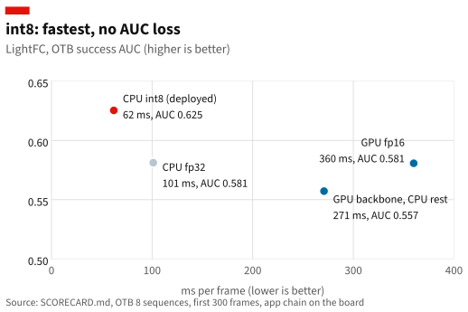

<!-- _class: lead -->
<!-- _paginate: false -->
<!-- _footer: '' -->

# A pan-tracking camera on the Arduino UNO Q

<p class="dek">Heterogeneous inference of YOLOv8n and LightFC on the QRB2210 CPU (4 Arm Cortex-A53) and GPU (Adreno 702), and using computer vision to drive a motor using the Arm Cortex-M33</p>

<p class="by">Bence Danko · ACM/IEEE SEC 2026 Student Innovation Challenge · Minimalist Edge AI, Hardware Track</p>

---

# Problem, and why on the device

<p class="dek">Select a class, e.g. "person", and the camera locates and uses a motor to pan to center.</p>

| Requirement | Reason |
|---|---|
| Privacy | Video stays on the board. |
| Latency | The motor loop runs on every frame. A network round trip would add to each step. |
| No network | Field sites often have none. |

Uses: laboratories, lecture rooms, care rooms, field and wildlife observation.

---

# Hardware

| Unit | Specification | Effect |
|---|---|---|
| CPU | 4× Cortex-A53, 2.0 GHz, Armv8.0 | NEON SIMD; no fp16 arithmetic |
| GPU | Adreno 702, Vulkan 1.0 | fp32 and fp16; no int8 (no 8-bit storage) |
| NPU | None usable | No QNN |
| RAM | 3.6 GB | |
| MCU | STM32U585 | Drives the motor from the tracker's commands |
| Power sensor | None | No energy measurement |

Runtime: ExecuTorch 1.5.1, XNNPACK on the CPU, Vulkan on the GPU. No PyTorch on the board.

---

# What runs where

<svg viewBox="0 0 1152 350" width="1152" height="350" xmlns="http://www.w3.org/2000/svg" font-family="'Source Sans 3', sans-serif" font-size="17">
  <defs>
    <marker id="ah" viewBox="0 0 10 10" refX="9" refY="5" markerWidth="7" markerHeight="7" orient="auto-start-reverse"><path d="M0,0 L10,5 L0,10 z" fill="#121212"/></marker>
    <marker id="ahb" viewBox="0 0 10 10" refX="9" refY="5" markerWidth="7" markerHeight="7" orient="auto-start-reverse"><path d="M0,0 L10,5 L0,10 z" fill="#006BA2"/></marker>
  </defs>
  <!-- camera -->
  <rect x="0" y="122" width="100" height="64" fill="#F2F2F2"/>
  <text x="12" y="148" font-weight="700">Camera</text>
  <text x="12" y="170" fill="#595959" font-size="15">USB, 640×480</text>
  <!-- SoC -->
  <rect x="126" y="8" width="740" height="334" fill="none" stroke="#595959" stroke-width="1.5" stroke-dasharray="6 4"/>
  <text x="140" y="30" font-size="13" font-weight="700" letter-spacing="1" fill="#595959">QUALCOMM QRB2210 · LINUX</text>
  <!-- CPU lane -->
  <rect x="140" y="42" width="712" height="172" fill="#FBE7E6"/>
  <text x="154" y="64" font-size="13" font-weight="700" letter-spacing="1" fill="#E3120B">CPU · 4× CORTEX-A53 · XNNPACK</text>
  <rect x="154" y="112" width="112" height="64" fill="#fff" stroke="#121212" stroke-width="1.5"/>
  <text x="166" y="138" font-weight="700">Capture</text>
  <text x="166" y="160" fill="#595959">decode, roll</text>
  <rect x="300" y="76" width="240" height="60" fill="#fff" stroke="#E3120B" stroke-width="2.5"/>
  <text x="312" y="100" font-weight="700">YOLOv8n · int8</text>
  <text x="312" y="122" fill="#595959">SEARCH · each frame · 89 ms</text>
  <rect x="300" y="146" width="240" height="60" fill="#fff" stroke="#E3120B" stroke-width="2.5"/>
  <text x="312" y="170" font-weight="700">LightFC · int8</text>
  <text x="312" y="192" fill="#595959">TRACK · each frame · 50 ms</text>
  <rect x="590" y="112" width="140" height="64" fill="#fff" stroke="#121212" stroke-width="1.5"/>
  <text x="602" y="138" font-weight="700">Controller</text>
  <text x="602" y="160" fill="#595959">step and settle</text>
  <!-- GPU lane -->
  <rect x="140" y="226" width="712" height="104" fill="#E3EEF5"/>
  <text x="568" y="248" font-size="13" font-weight="700" letter-spacing="1" fill="#006BA2">GPU · ADRENO 702 · VULKAN</text>
  <rect x="300" y="258" width="240" height="60" fill="#fff" stroke="#006BA2" stroke-width="2.5"/>
  <text x="312" y="282" font-weight="700">YOLOv8n · fp16</text>
  <text x="312" y="304" fill="#595959">TRACK check · each 1 s · 616 ms</text>
  <text x="568" y="282" fill="#595959" font-size="16">CPU cost of the check: 5.6 M cycles</text>
  <text x="568" y="304" fill="#595959" font-size="16">(709 M cycles if it ran on the CPU)</text>
  <!-- MCU + motor -->
  <rect x="886" y="112" width="172" height="64" fill="#fff" stroke="#121212" stroke-width="1.5"/>
  <text x="898" y="138" font-weight="700">STM32U585</text>
  <text x="898" y="160" fill="#595959" font-size="15">motor driver</text>
  <rect x="1080" y="122" width="72" height="44" fill="#F2F2F2"/>
  <text x="1092" y="149" font-weight="700">Motor</text>
  <!-- arrows -->
  <line x1="100" y1="154" x2="152" y2="154" stroke="#121212" stroke-width="1.5" marker-end="url(#ah)"/>
  <polyline points="266,134 282,134 282,106 298,106" fill="none" stroke="#121212" stroke-width="1.5" marker-end="url(#ah)"/>
  <polyline points="266,154 282,154 282,176 298,176" fill="none" stroke="#121212" stroke-width="1.5" marker-end="url(#ah)"/>
  <polyline points="210,176 210,288 298,288" fill="none" stroke="#006BA2" stroke-width="1.5" marker-end="url(#ahb)"/>
  <line x1="420" y1="136" x2="420" y2="144" stroke="#121212" stroke-width="1.5" marker-end="url(#ah)"/>
  <line x1="490" y1="256" x2="490" y2="208" stroke="#006BA2" stroke-width="1.5" stroke-dasharray="5 3" marker-end="url(#ahb)"/>
  <text x="482" y="242" fill="#006BA2" font-size="15" text-anchor="end">restart or LOST</text>
  <polyline points="540,176 562,176 562,154 588,154" fill="none" stroke="#121212" stroke-width="1.5" marker-end="url(#ah)"/>
  <line x1="730" y1="144" x2="884" y2="144" stroke="#121212" stroke-width="1.5" marker-end="url(#ah)"/>
  <text x="764" y="134" fill="#595959" font-size="15">RPC, 6.7 ms</text>
  <line x1="1058" y1="144" x2="1078" y2="144" stroke="#121212" stroke-width="1.5" marker-end="url(#ah)"/>
</svg>

<p class="small">Per-frame work on the CPU. The once-a-second check on the GPU, which is otherwise idle.</p>

---

# Software pipeline

<p class="dek">One process, five threads. CPU and GPU run concurrently.</p>

<svg viewBox="0 0 1152 300" width="1000" height="260" xmlns="http://www.w3.org/2000/svg" font-family="'Source Sans 3', sans-serif" font-size="16">
<defs><marker id="pa" viewBox="0 0 10 10" refX="9" refY="5" markerWidth="7" markerHeight="7" orient="auto"><path d="M0,0 L10,5 L0,10 z" fill="#006BA2"/></marker></defs>
<line x1="250" y1="68" x2="1140" y2="68" stroke="#D9D9D9"/>
<text x="0" y="58" font-weight="700">Capture</text>
<text x="0" y="78" fill="#595959" font-size="14">CPU · OpenCV</text>
<line x1="250" y1="128" x2="1140" y2="128" stroke="#D9D9D9"/>
<text x="0" y="118" font-weight="700">Tracker</text>
<text x="0" y="138" fill="#595959" font-size="14">CPU · LightFC int8, 4 workers</text>
<line x1="250" y1="188" x2="1140" y2="188" stroke="#D9D9D9"/>
<text x="0" y="178" font-weight="700">Check</text>
<text x="0" y="198" fill="#595959" font-size="14">GPU · YOLOv8n fp16</text>
<line x1="250" y1="248" x2="1140" y2="248" stroke="#D9D9D9"/>
<text x="0" y="238" font-weight="700">Motor</text>
<text x="0" y="258" fill="#595959" font-size="14">CPU · RPC every 50 ms</text>
<rect x="250.0" y="52" width="10.7" height="26" fill="#595959"/>
<rect x="309.6" y="52" width="10.7" height="26" fill="#595959"/>
<rect x="369.3" y="52" width="10.7" height="26" fill="#595959"/>
<rect x="428.9" y="52" width="10.7" height="26" fill="#595959"/>
<rect x="488.5" y="52" width="10.7" height="26" fill="#595959"/>
<rect x="548.1" y="52" width="10.7" height="26" fill="#595959"/>
<rect x="607.8" y="52" width="10.7" height="26" fill="#595959"/>
<rect x="667.4" y="52" width="10.7" height="26" fill="#595959"/>
<rect x="727.0" y="52" width="10.7" height="26" fill="#595959"/>
<rect x="786.7" y="52" width="10.7" height="26" fill="#595959"/>
<rect x="846.3" y="52" width="10.7" height="26" fill="#595959"/>
<rect x="905.9" y="52" width="10.7" height="26" fill="#595959"/>
<rect x="965.6" y="52" width="10.7" height="26" fill="#595959"/>
<rect x="1025.2" y="52" width="10.7" height="26" fill="#595959"/>
<rect x="1084.8" y="52" width="10.7" height="26" fill="#595959"/>
<rect x="260.7" y="112" width="56.1" height="26" fill="#E3120B"/>
<rect x="320.3" y="112" width="56.1" height="26" fill="#E3120B"/>
<rect x="379.9" y="112" width="56.1" height="26" fill="#E3120B"/>
<rect x="439.6" y="112" width="56.1" height="26" fill="#E3120B"/>
<rect x="499.2" y="112" width="56.1" height="26" fill="#E3120B"/>
<rect x="558.8" y="112" width="56.1" height="26" fill="#E3120B"/>
<rect x="618.5" y="112" width="56.1" height="26" fill="#E3120B"/>
<rect x="678.1" y="112" width="56.1" height="26" fill="#E3120B"/>
<rect x="737.7" y="112" width="56.1" height="26" fill="#E3120B"/>
<rect x="797.4" y="112" width="56.1" height="26" fill="#E3120B"/>
<rect x="857.0" y="112" width="56.1" height="26" fill="#E3120B"/>
<rect x="916.6" y="112" width="56.1" height="26" fill="#E3120B"/>
<rect x="976.2" y="112" width="56.1" height="26" fill="#E3120B"/>
<rect x="1035.9" y="112" width="56.1" height="26" fill="#E3120B"/>
<rect x="396.0" y="172" width="576.7" height="26" fill="#006BA2"/>
<text x="404.9" y="190" fill="#fff" font-weight="700">YOLOv8n check on the GPU · 648 ms</text>
<line x1="387.1" y1="140" x2="396.0" y2="170" stroke="#006BA2" stroke-width="2" marker-end="url(#pa)"/>
<line x1="972.7" y1="172" x2="981.6" y2="142" stroke="#006BA2" stroke-width="2" marker-end="url(#pa)"/>
<rect x="250.0" y="232" width="4" height="26" fill="#121212"/>
<rect x="294.5" y="232" width="4" height="26" fill="#121212"/>
<rect x="339.0" y="232" width="4" height="26" fill="#121212"/>
<rect x="383.5" y="232" width="4" height="26" fill="#121212"/>
<rect x="428.0" y="232" width="4" height="26" fill="#121212"/>
<rect x="472.5" y="232" width="4" height="26" fill="#121212"/>
<rect x="517.0" y="232" width="4" height="26" fill="#121212"/>
<rect x="561.5" y="232" width="4" height="26" fill="#121212"/>
<rect x="606.0" y="232" width="4" height="26" fill="#121212"/>
<rect x="650.5" y="232" width="4" height="26" fill="#121212"/>
<rect x="695.0" y="232" width="4" height="26" fill="#121212"/>
<rect x="739.5" y="232" width="4" height="26" fill="#121212"/>
<rect x="784.0" y="232" width="4" height="26" fill="#121212"/>
<rect x="828.5" y="232" width="4" height="26" fill="#121212"/>
<rect x="873.0" y="232" width="4" height="26" fill="#121212"/>
<rect x="917.5" y="232" width="4" height="26" fill="#121212"/>
<rect x="962.0" y="232" width="4" height="26" fill="#121212"/>
<rect x="1006.5" y="232" width="4" height="26" fill="#121212"/>
<rect x="1051.0" y="232" width="4" height="26" fill="#121212"/>
<rect x="1095.5" y="232" width="4" height="26" fill="#121212"/>
<rect x="1140.0" y="232" width="4" height="26" fill="#121212"/>
<text x="250.0" y="292" fill="#595959" font-size="14" text-anchor="middle">0 ms</text>
<text x="472.5" y="292" fill="#595959" font-size="14" text-anchor="middle">250 ms</text>
<text x="695.0" y="292" fill="#595959" font-size="14" text-anchor="middle">500 ms</text>
<text x="917.5" y="292" fill="#595959" font-size="14" text-anchor="middle">750 ms</text>
<text x="1140.0" y="292" fill="#595959" font-size="14" text-anchor="end">1000 ms</text>
<text x="387.1" y="30" fill="#006BA2" font-size="14">frame handed over; tracker does not wait</text>
<line x1="387.1" y1="36" x2="387.1" y2="104" stroke="#006BA2" stroke-dasharray="4 3"/>
</svg>

<div class="cols small">
<div>

- Inference and image calls run in C++ (`libinfer.so`, OpenCV) and release the Python GIL.
- One-frame slot: newest frame only, no queue.

</div>
<div>

- The tracker hands a frame to the GPU check and does not wait for the result.
- Live: GPU 60 % busy while the process uses 317 % of 400 % CPU.

</div>
</div>

---

# Software stack

| Unit | Software |
|---|---|
| CPU, 4× Cortex-A53 | ExecuTorch 1.5.1 + XNNPACK (NEON kernels, 4 threads), in our `libinfer.so`: 5-function C API, called via `ctypes`. |
| GPU, Adreno 702 | ExecuTorch Vulkan backend → Mesa Turnip 25.2.6 → msm kernel driver, Linux 6.16.7 |
| MCU, STM32U585 | Arduino sketch, Zephyr core. RPCs `set_motor`, `stop` via Arduino_RouterBridge |
| Linux → MCU link | msgpack-rpc → `/run/arduino-router.sock` → arduino-router → STM32 |
| Application | Python 3.13; OpenCV 5.0 (capture, decode, crop); NumPy 2.5 (box decode, NMS); Flask 3.1 (UI) |
| Export (laptop) | PyTorch 2.14, ExecuTorch 1.5.1 exporter; int8 via torchao PT2E + XNNPACKQuantizer; fp16 via `force_fp16` |

---

# ExecuTorch for CPU or GPU delegation

<div class="cols">
<div>

### Export, on the laptop

```python
if variant == "xnn8":                  # int8 for the CPU
    model = quantize_pt2e(model, example, calib)
part = {
    "xnn8": XnnpackPartitioner(),      # CPU
    "vk16": VulkanPartitioner(
        {"force_fp16": True}),         # GPU
}[variant]
ep = torch.export.export(model, example)
prog = to_edge_transform_and_lower(
    ep, partitioner=[part]).to_executorch()
prog.write_to_file(open(out_path, "wb"))
```

</div>
<div>

### Run, on the board

```python
cpu = Model("yolov8n_xnn8_320.pte", threads=4)
gpu = Model("yolov8n_vk16_320.pte")

boxes = cpu.run(image)   # same call
boxes = gpu.run(image)   # same call
```

`Model`: our `ctypes` wrapper on `libinfer.so`. The delegate (XNNPACK or Vulkan) is inside the `.pte`.

</div>
</div>

---

# Models

| | YOLOv8n | LightFC (MobileNetV2) |
|---|---|---|
| Task | Find an object of a COCO class | Follow it |
| Classes | 80 (COCO) | Any object (template) |
| Input | 320×320 image | 128×128 template, 256×256 search area |
| Runs | SEARCH: every frame. TRACK: check once a second | TRACK: every frame |
| Used as | CPU int8 for SEARCH, GPU fp16 for the check | CPU int8 |

| State | Operation |
|---|---|
| SEARCH | YOLOv8n on every frame; motor still |
| TRACK | LightFC on every frame; motor pulses; YOLOv8n check once a second |
| LOST | Motor stops; back to SEARCH |

---

# Test data and calibration

| | LightFC | YOLOv8n |
|---|---|---|
| Weights | Authors' release (LaSOT, GOT-10k, COCO, TrackingNet). Not retrained. | Ultralytics release (COCO). Not retrained. |
| int8 calibration | 64 template/search crop pairs from 6 OTB100 sequences outside the test set: Bolt, Car4, Coke, Crossing, Deer, Dog1 | 200 images (14 sequences) |
| Accuracy test | OTB100, 8 sequences: Basketball, Biker, BlurCar2, David3, Girl2, Human3, Jogging-1, Walking2. 5,709 frames. Success AUC, precision at 20 px | No mAP. Box agreement only. |
| Agreement test | 20 crop pairs, score difference vs PyTorch | Host: vs Ultralytics (OTB100 first frames, 10 camera frames). Board: vs CPU fp32 (first frame of each test sequence) |

<p class="small muted">OTB100: Wu, Lim and Yang, TPAMI 2015. Sequences chosen for horizontal motion, fast motion, occlusion and scale change. All accuracy tests run on the board.</p>

---

# Quantization

<table class="tight" style="font-size:18px">
<tr><th></th><th>LightFC</th><th>YOLOv8n</th></tr>
<tr><th colspan="3">int8 on the CPU, XNNPACK</th></tr>
<tr><td>Method</td><td colspan="2">Static post-training quantization, PyTorch PT2E + XNNPACKQuantizer</td></tr>
<tr><td>Weights</td><td colspan="2">int8, symmetric, per output channel; range −127…127, zero-point 0, scale = max |w| / 127</td></tr>
<tr><td>Activations</td><td colspan="2">int8, asymmetric, per tensor; range −128…127; scale and zero-point from a histogram observer</td></tr>
<tr><td>Quantized part</td><td>Per block; fusion and head calibrated on fp32 outputs of the preceding blocks</td><td>Whole network to the raw outputs; box decode stays fp32</td></tr>
<tr><td>Calibration data</td><td>64 crop pairs</td><td>200 images</td></tr>
<tr><td>Kernels</td><td colspan="2">XNNPACK int8 NEON kernels</td></tr>
<tr><td>Result vs fp32</td><td><strong>−43 %</strong> latency, <strong>−73 %</strong> size; AUC 0.625 vs 0.581</td><td><strong>−20 %</strong> latency, <strong>−74 %</strong> size; box IoU 0.972</td></tr>
<tr><th colspan="3">fp16 on the GPU, Vulkan</th></tr>
<tr><td>Method</td><td colspan="2">Cast at export (<code>force_fp16</code>); weights and activations fp16; no calibration</td></tr>
<tr><td>Result vs fp32</td><td>−11 % latency, −50 % size; AUC unchanged (0.581)</td><td>−22 % latency, −50 % size; box IoU 0.999</td></tr>
</table>


---

# Quantization pipeline

<svg viewBox="0 0 1152 546" width="1152" height="510" xmlns="http://www.w3.org/2000/svg" font-family="'Source Sans 3', sans-serif" font-size="17">
<defs><marker id="qa" viewBox="0 0 10 10" refX="9" refY="5" markerWidth="7" markerHeight="7" orient="auto"><path d="M0,0 L10,5 L0,10 z" fill="#121212"/></marker></defs>
<rect x="0" y="0" width="450" height="46" fill="#fff" stroke="#121212" stroke-width="1.8"/>
<text x="12" y="20" font-weight="700">LightFC or YOLOv8n</text>
<text x="12" y="39" fill="#595959" font-size="15">PyTorch nn.Module, fp32</text>
<rect x="0" y="80" width="450" height="46" fill="#fff" stroke="#121212" stroke-width="1.8"/>
<text x="12" y="100" font-weight="700">ExportedProgram</text>
<text x="12" y="119" fill="#595959" font-size="15">static fp32 graph</text>
<rect x="0" y="160" width="450" height="46" fill="#fff" stroke="#121212" stroke-width="1.8"/>
<text x="12" y="180" font-weight="700">Graph with observers</text>
<text x="12" y="199" fill="#595959" font-size="15">histogram for activations, per-channel min/max for weights</text>
<rect x="0" y="240" width="450" height="46" fill="#fff" stroke="#121212" stroke-width="1.8"/>
<text x="12" y="260" font-weight="700">Calibrated graph</text>
<text x="12" y="279" fill="#595959" font-size="15">value ranges recorded</text>
<rect x="0" y="320" width="450" height="46" fill="#fff" stroke="#121212" stroke-width="1.8"/>
<text x="12" y="340" font-weight="700">Graph with Q/DQ nodes</text>
<text x="12" y="359" fill="#595959" font-size="15">int8 scales and zero-points; arithmetic still fp32</text>
<rect x="0" y="416" width="450" height="46" fill="#FBE7E6" stroke="#E3120B" stroke-width="1.8"/>
<text x="12" y="436" font-weight="700">.pte file</text>
<text x="12" y="455" fill="#595959" font-size="15">int8 XNNPACK operators, int8 weights</text>
<rect x="0" y="496" width="450" height="46" fill="#E3EEF5" stroke="#006BA2" stroke-width="1.8"/>
<text x="12" y="516" font-weight="700">On the board</text>
<text x="12" y="535" fill="#595959" font-size="15">ExecuTorch runtime → XNNPACK int8 NEON kernels</text>
<line x1="40" y1="46" x2="40" y2="78" stroke="#121212" stroke-width="1.8" marker-end="url(#qa)"/>
<text x="56" y="68" font-family="'DejaVu Sans Mono', monospace" font-size="14" xml:space="preserve">torch.export.export(model, example)</text>
<text x="640" y="68" fill="#E3120B" font-size="15" font-weight="700">PyTorch</text>
<line x1="40" y1="126" x2="40" y2="158" stroke="#121212" stroke-width="1.8" marker-end="url(#qa)"/>
<text x="56" y="148" font-family="'DejaVu Sans Mono', monospace" font-size="14" xml:space="preserve">prepare_pt2e(graph, XNNPACKQuantizer())</text>
<text x="640" y="148" fill="#E3120B" font-size="15" font-weight="700">torchao + ExecuTorch quantizer rules</text>
<line x1="40" y1="206" x2="40" y2="238" stroke="#121212" stroke-width="1.8" marker-end="url(#qa)"/>
<text x="56" y="228" font-family="'DejaVu Sans Mono', monospace" font-size="14" xml:space="preserve">graph(*sample)  for each calibration sample</text>
<text x="640" y="228" fill="#E3120B" font-size="15" font-weight="700">64 crop pairs / 200 images</text>
<line x1="40" y1="286" x2="40" y2="318" stroke="#121212" stroke-width="1.8" marker-end="url(#qa)"/>
<text x="56" y="308" font-family="'DejaVu Sans Mono', monospace" font-size="14" xml:space="preserve">convert_pt2e(graph)</text>
<text x="640" y="308" fill="#E3120B" font-size="15" font-weight="700">torchao</text>
<line x1="40" y1="366" x2="40" y2="414" stroke="#121212" stroke-width="1.8" marker-end="url(#qa)"/>
<text x="56" y="388" font-family="'DejaVu Sans Mono', monospace" font-size="14" xml:space="preserve">to_edge_transform_and_lower(torch.export.export(graph),</text>
<text x="56" y="404" font-family="'DejaVu Sans Mono', monospace" font-size="14" xml:space="preserve">    partitioner=[XnnpackPartitioner()]).to_executorch()</text>
<text x="640" y="396" fill="#E3120B" font-size="15" font-weight="700">ExecuTorch</text>
<line x1="40" y1="462" x2="40" y2="494" stroke="#121212" stroke-width="1.8" marker-end="url(#qa)"/>
<text x="56" y="484" font-family="'DejaVu Sans Mono', monospace" font-size="14" xml:space="preserve">Model("model.pte")  →  infer_load()</text>
<text x="640" y="484" fill="#E3120B" font-size="15" font-weight="700">libinfer.so</text>
</svg>

---

# Measurement tools

| Value | Tool |
|---|---|
| Model latency, p50 and p95 | `infer_bench` (our C++ harness), `CLOCK_MONOTONIC`, 200 runs after warm-up (YOLOv8n: 50) |
| CPU cycles, IPC, L2 traffic | `perf stat` 7.2, A53 PMU, user space; per frame = (N runs − 0 runs) / N |
| Peak RAM | `getrusage` `ru_maxrss` (separate run); app: `/proc/<pid>/status` |
| CPU load | `/proc/<pid>/stat` utime + stime per wall second (400 % = 4 cores) |
| GPU load and clock | DRM fdinfo `drm-engine-gpu` busy ns per wall second; clock from devfreq |
| GPU time per shader | ExecuTorch ETDump (Vulkan timestamp queries) |
| Temperature | hwmon (cpuss, gpu) |
| RPC to the STM32 | `time.monotonic()` around each `set_motor` call, send to reply |
| Capture to motor command | Frame capture time → return of the RPC that starts the pulse |
| Live values | App `/state` endpoint, last 60 samples |

---

# LightFC precision

| Processor, precision | p50 ms | p95 ms | Size MB | Peak RAM MB | CPU Mcycles/frame | L2 traffic MB/frame | OTB AUC | Max error vs PyTorch |
|---|---|---|---|---|---|---|---|---|
| CPU fp32 | 86.5 | 105.7 | 12.7 | 26 | 643 | 461 | 0.581 | < 1e-5 |
| **CPU int8, in use** | **49.6** | **77.5** | **3.4** | **13** | **358** | **31.7** | **0.625** | 0.073 |
| GPU fp32 | 364.5 | 365.8 | 12.7 | 70 | 3.4 | 3.5 | – | 8e-5 |
| GPU fp16 | 325.9 | 327.0 | 6.4 | 70 | 9.8 | 4.6 | 0.581 | 0.004 |

<p class="small muted">Backbone + fusion + head, 4 threads, 200 runs. AUC: 8 OTB100 test sequences, first 300 frames each (2,194 frames). Error: max score difference vs PyTorch, 20 crop pairs. –: not measured.</p>

- CPU int8 vs fp32: −43 % latency, −73 % size, −50 % RAM, −93 % L2 traffic; AUC 0.625 vs 0.581.
- GPU fp16 vs fp32: −11 % latency, −50 % size; AUC unchanged.
- GPU vs CPU fp32: 4.2× slower (fp32), 3.8× slower (fp16).

---

# Trackers compared on OTB100

<div class="cols">
<div>



</div>
<div>

| Tracker | Runtime | ms/frame | AUC | P@20 |
|---|---|---|---|---|
| KCF | OpenCV | 21.4 | 0.286 | 0.362 |
| NanoTrack v2 | OpenCV | 28.5 | 0.544 | 0.786 |
| LightFC fp32, authors | PyTorch, CUDA | – | 0.616 | 0.857 |
| **LightFC fp32, ours** | **ExecuTorch, CPU** | 99.8 | **0.620** | **0.856** |

<p class="small muted">Full sequences, 5,709 frames. ms/frame: one update on the board, crop included. Authors: their published trajectories, scored with our script.</p>

<p class="small">NanoTrack: 3.5× faster, AUC 0.075 lower. Our port vs the authors' boxes: mean IoU 0.938.</p>

</div>
</div>

---

# YOLOv8n precision

| Processor, precision | p50 ms | p95 ms | Size MB | Peak RAM MB | CPU Mcycles/frame | L2 traffic MB/frame | Box IoU vs CPU fp32 | Use |
|---|---|---|---|---|---|---|---|---|
| CPU fp32 | 111.9 | 124.8 | 12.7 | 32 | 709 | 157 | 1.000 | – |
| **CPU int8** | **89.4** | **93.0** | **3.3** | **23** | 554 | 66.5 | 0.972 | **SEARCH** |
| GPU fp32 | 789.4 | 790.5 | 12.7 | 72 | 6.2 | 6.0 | 1.000 | – |
| **GPU fp16** | **615.7** | 616.8 | 6.4 | 72 | **5.6** | **5.9** | 0.999 | **TRACK check** |

<p class="small muted">4 threads, 50 runs. Box IoU vs CPU fp32 on the first frame of each OTB100 test sequence. CPU fp32 vs Ultralytics: 0.994. No mAP.</p>

- CPU int8 vs fp32: −20 % latency, −74 % size, −29 % RAM, −58 % L2 traffic.
- int8 scores saturate near 0.80; with several people, the top box can change.
- GPU fp16 vs fp32: −22 % latency; boxes unchanged.
- int8 holds because the network outputs raw values; box decode runs in fp32 (NumPy).

---

# Efficiency scorecard

| Metric | LightFC portable fp32 | LightFC XNNPACK fp32 | LightFC XNNPACK int8 | YOLOv8n XNNPACK fp32 | YOLOv8n XNNPACK int8 |
|---|---|---|---|---|---|
| Model size, MB | 18.2 | 12.7 | **3.4** | 12.7 | **3.3** |
| Peak RAM, MB | 23 | 26 | **13** | 32 | **23** |
| Latency p50, ms | 34,734 | 86.5 | **49.6** | 111.9 | **89.4** |
| Throughput, FPS | 0.03 | 11.6 | **20.2** | 8.9 | **11.2** |
| Energy | Not measured | | | | |
| CPU cycles per frame, M | 69,511 | 643 | **358** | 709 | **554** |
| L2 traffic per frame, MB | 3,626 | 461 | **31.7** | 157 | **66.5** |

<p class="small muted">Portable fp32: ExecuTorch reference kernels, no XNNPACK. The XNNPACK LightFC columns use the authors' inference form of the model. Int8 columns are the models in use. No power sensor on the board; CPU cycles and L2 traffic (A53 PMU) stand in for energy.</p>

---

# Live system

| Metric | p50 | p95 |
|---|---|---|
| Tracking rate (TRACK) | 14.4 FPS | |
| Capture to motor command | 142 ms | 183 ms |
| Tracker step (crop + LightFC int8 + decode) | 67 ms | 77 ms |
| Detector step (SEARCH, CPU int8) | 131 ms | 163 ms |
| GPU check (fp16) | 648 ms | 661 ms |
| RPC to the STM32 | 6.3 ms | 9.1 ms |
| Application RAM | 200 MB | |

- Camera: 15.0 FPS.
- 1,451 frames: 0 exceptions, 0 RPC errors. 17 of 73 GPU checks discarded: the camera moved after capture.

<p class="src">Source: app /state endpoint, last 60 samples, 2026-10-13, 4 XNNPACK threads, one person walking.</p>

---

# Lessons

- First detector: YOLOE (open vocabulary). Too slow on the CPU, and int8 broke its boxes. Replaced by YOLOv8n.
- Tracker and detector together on the CPU competed for cores: variable latency in the demo. Moving the detector check to the GPU removed the contention.

---

# Future work

1. Smoother motor motion while tracking.
2. YOLOv8n with a single-class output.
3. Tracking tests on smaller targets, for precision.

---

<!-- _class: lead -->
<!-- _paginate: false -->

# Questions
